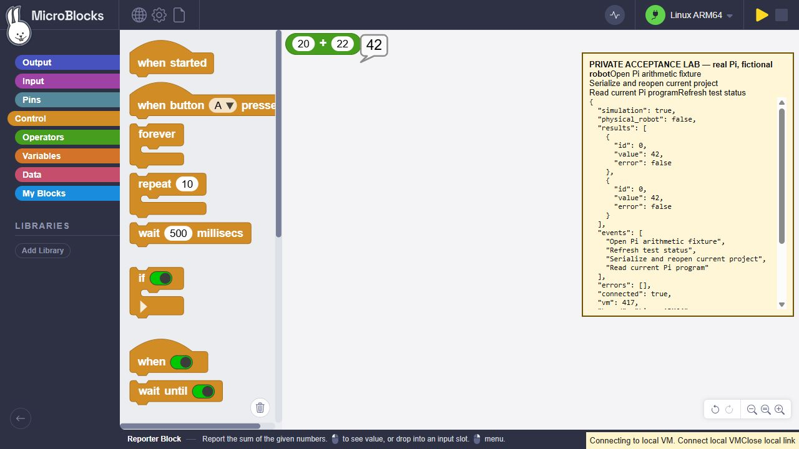
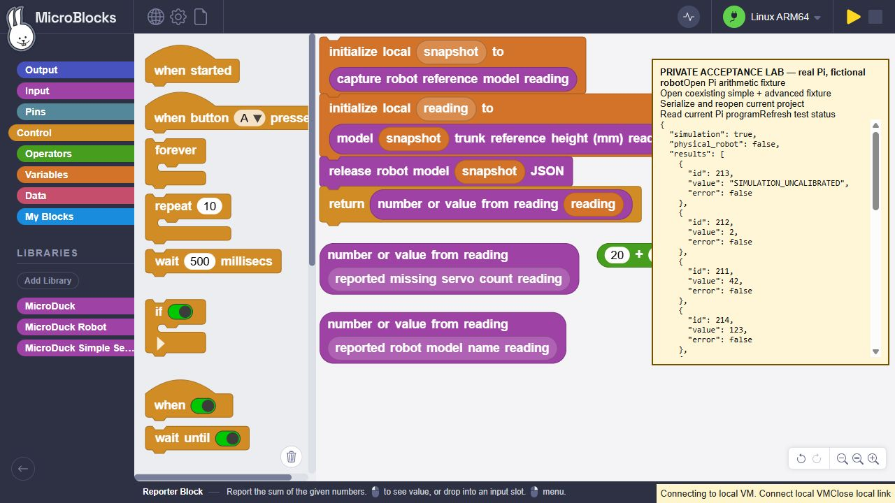

# Real Pi graphical readback and coexisting libraries

2026-10-28, isolated migration branch, starting at 9ba2f25. No push, live-site
change, GP/main change, board access, real robot action, security change or reboot.

## Result

- A fresh **ordinary AArch64** SmallVM built on RPI5 from the pinned v417 port.
  SHA256: `34416161437bb3195f6063838f1dadc777a6d35828914cda30a4b5a5a4546d8b`.
  Its actual interpreter/PTY self-test and all **six** focused model/servo tests
  pass. These use fictional robotd data, not physical MicroDuck measurements.
- The **standalone Raspberry Pi 5 profile**, with no gateway or robot libraries,
  connects graphically, executes 20+22=42, serializes/reopens, disconnects/reconnects,
  reads the saved VM program and executes its reconstructed reporter as 42 again.
- A separate **Linux development profile** imports the optional Starter Lab:
  **10 libraries / 211 functions**, with simple and advanced blocks in one project.
  Real graphical clicks execute the simple missing-servo count/model-name helpers
  alongside the advanced capture/read/release reference-height script. Expected
  fictional results are 2, `SIMULATION_UNCALIBRATED`, and 123 mm; arithmetic returns 42.
- Graphical readback retains the **three used libraries / 107 source functions**
  and four scripts. It does not preserve unused libraries. After reopen, reconnect
  and another readback, all four results remain correct. A final independent
  read-only protocol inventory finds **19 stored chunks and four scripts**.
  The normal editor downloads reachable functions;211 is the imported source
  count, not a claim that 211 functions were all executed graphically.
- The unchanged full validator passes **541 tests, zero failures, zero skips**
  in 318.331s. Its wrapper verifies all **2,440 frozen inputs** remain byte-identical
  in the source and Linux replica. The focused actual-editor-class test now has
  **14 checks**, including five added lifecycle regressions. Local native tests
  use the separately verified x86-64 ASan/UBSan VM; that binary is not the Pi VM.

## Bug found and fixed

Before correction, rapid initial evaluations can overlap three downloads. A fresh
code manager after readback also allocates new slot identities, allowing later
uploads to overwrite an unrelated retained VM chunk and leave duplicate scripts.
The first real Pi attempt recorded a primitive-not-implemented error for the
model-name helper; the subsequent read found eight scripts and 35 chunks.

The local adapter now queues evaluation preparation/dispatch per manager and
adopts verified function/script slot bindings through the editor's project clone
and layout changes. Runtime tasks remain concurrent. Binding adoption sends no
board writes and is scoped to the same port/read generation and unchanged program
content. Changed projects/connections reject stale plans. Failed requests remain
visible and do not poison the next explicit evaluation. Upstream engine files and
the VM pin are unchanged. See [the contract](../../../docs/JS_PI_READBACK_SPEC.md).

The old adapter is a negative control: the new regression fails with
`3 !== 1` simultaneous downloads. The corrected adapter passes. The original
graphical failure/bytecode and final positive results are kept separately.

## Evidence and limits

[Final verification](final-verification.json), [full run](full-validation-receipt.json),
[frozen inputs](frozen-validation-inputs.json), [Pi build](pi-build.json),
[standalone graphical results](graphical-standalone.json),
[corrected typed results](graphical-model-fixed.json),
[final inventory](final-vm-inventory.json), [cleanup](cleanup.json),
[negative control](negative-control.json), and [raw Pi receipts](raw-pi-receipts.zip).
The source/file-hash record was made during preparation; the separate full-run
receipt records the completed validation. Reproduction scripts and raw bytecode
captures are bounded audit fixtures, not installers or production editor assets.
Generated Windows JSON receipts are normalized from CRLF to LF without changing
their JSON values. [Original text](raw-windows-text.zip) and the
[conversion hashes](text-normalization.json) preserve the exact frozen bytes.
The earlier hash records describe those raw bytes; the packaged-file manifest
records the committed LF copies. Product and test sources remain unchanged.

The first complete run used a Python environment without `websockets`, yielding
14 skips and three session failures. Both logs are preserved in
[validation-logs.zip](validation-logs.zip). The final run uses the existing pinned
websockets 15.0.1 environment and passes without changing deadlines or exclusions.

The graphical test uses visible test controls calling actual editor import,
serialization/reopen and readback APIs, then actual canvas clicks through the
ordinary loopback WebSocket bridge to the real Pi VM. It does **not** claim a new
browser Save dialog or downloaded-file acceptance. The upstream v421 firmware
notice is acknowledged; the tested runtime stays v417. The Pi lab's common
fixture banner says "fictional robot" even in the standalone profile; that profile
has no robot connection. The development fixture's complete request audit contains
only `hello`, `robot.health`, and `robot.model`.

Both private foreground sessions and temporary SSH tunnels were stopped. All
three pre-existing Pi VMs retain their original PIDs, executable paths and start
identities. No user service, unrelated software, Caddy, firewall or startup setting
was modified. Physical MicroDuck, other graphical block families, live motion,
camera commissioning, mediad audio, installed service/reboot acceptance and a
published release remain outside this pass. MicroDuck's placeholder gate stays off.

