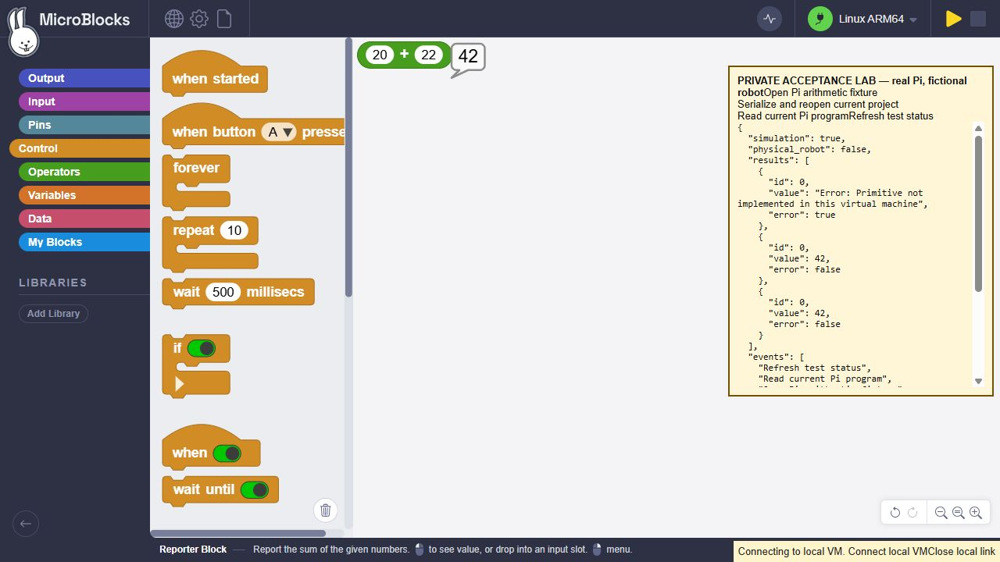

# Authorized full Raspberry Pi reboot acceptance

After the non-disruptive service test, Fred explicitly authorized rebooting Pi 5
as needed for testing. Exactly one reboot was issued. This later test supersedes
the earlier no-reboot limitation for the scope below. Windows was not rebooted.

The test records system/user services, three existing VM PIDs/arguments/start
identities, boot identity and private copies of all three saved program files.
Backups stay mode-private on the Pi; their contents are not uploaded or committed.
All three original files match their saved SHA256 after reboot. Foreground VMs
4819, 5601 and 6874 end at reboot and are not automatically reconstructed; their
simulation/bridge sessions are not claimed restored. Every previously running
system service is running again. The previous failed OpenClaw unit is absent
from the post-boot failed-unit list; no reset or configuration edit was performed.

## What passed

- Host RPI5/aarch64 returns through strict-host-key passwordless SSH with a
  different boot ID. First successful observation is at 13.71 s uptime.
- The installed test VM starts automatically at 8.653883 s since boot, before
  that first SSH observation. Its service retains all hardening. `Linger=yes`
  existed before testing and is unchanged; the installer does not enable it.
- The sealed GUI-generated arithmetic program and CRC 4087428137 survive the
  full reboot. The real interpreter returns 42. Pre-reboot file SHA256 is
  `793b3a2f02e4371cff270f3323e8d45b3df0b8483fd72bb4706ef9ddcc5ab07f`.
- Only the separate foreground bridge and temporary SSH forward are relaunched
  manually. The same real JS editor page reconnects, reads the stored project,
  reconstructs 20+22 and returns 42 on a canvas click. This does not claim an
  automatically hosted editor/bridge service or WSS/Pages commissioning.
- Test unit/enable link/launcher, bridge, SSH forwards and test tab are removed
  or stopped. Final VM inventory is empty. Versioned binaries, program files and
  private recovery copies remain. The subsequent editor synchronization changes
  the program-file representation; a fresh process loads that final file and
  independently returns 42. In the raw receipt `program_retained:false` describes
  exact pre-GUI hash inequality, not missing data; `program_file_exists_after_cleanup`
  is true and the final fresh-process result is42.

## Observed graphical limitation

Before reboot, the first transition from a deliberately minimal raw protocol
reporter through readback into a graphical project produced a primitive error.
The protocol independently executed the persisted graphical bytecode as42; an
explicit editor reconnect then returned42 graphically. Its cause is not yet
established and is retained as a regression/investigation gate. No success is
claimed for that first click. The later post-reboot readback/evaluation passes
on its first attempt. The complete GUI result history preserves the error and
both positive results. The v417/v421 compatibility notice was acknowledged;
the runtime was not upgraded. No browser/security warning was bypassed.

The first pre-reboot graphical setup also refused an older editor asset hash.
No reboot occurred then. The test subsequently copied 573 verified Pi-profile
package files into its own directory and applied the current readback adapter;
existing editor directories were not edited. No robot daemon was connected.
The common fixture banner says fictional robot, but this standalone project
uses no robot data.

[Final raw receipt](reboot-final-receipt.json), [first SSH return](reboot-reconnect.json),
[complete graphical history](graphical-after.json) and [test scripts/raw attempts](raw-reboot-evidence.zip).
Saved programs/model weights/credentials are not included. Windows reboot,
other ARM64 hardware, shipping MicroDuck and unattended bridge/editor startup
remain outside this result.

