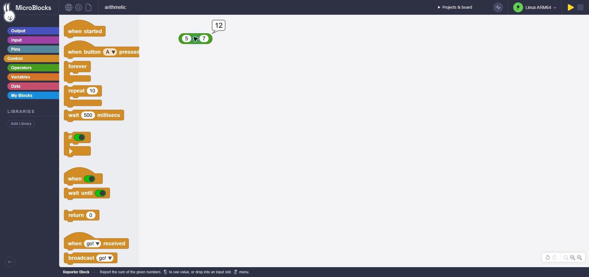
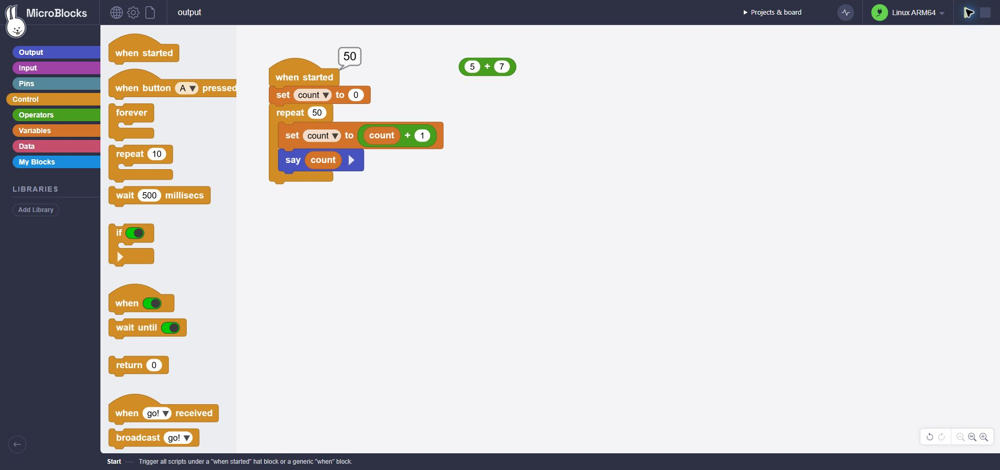

# Linux ARM64 evidence, 2026-10-27

The physical target was Raspberry Pi 5 Model B Rev 1.0, Debian 13.4 AArch64,
kernel 6.12.75+rpt-rpi-2712, GCC 14.2, glibc 2.41. Baseline inventory was taken
over verified SSH before project installation. Existing Caddy and other services
were preserved; OpenClaw's user service was already failed in that inventory.

| Evidence | Scope |
|---|---|
| [pi5-native-release.json](pi5-native-release.json) | Actual ARMv8-A build and PTY interpreter, 100 arithmetic executions, variables, uploads, live edits, stop, compaction, process restart/autostart, process-kill durability and corrupt-file refusal. |
| [pi5-native-sanitizers.json](pi5-native-sanitizers.json) | Same suite on a native ASan/UBSan build. |
| [pi5-source-manifest.json](pi5-source-manifest.json) | Exact original/prepared hashes of the tested native source files; MPL source pin retained. |
| [pi5-reproducible-build.txt](pi5-reproducible-build.txt) | A second native build from identical verified inputs produced the same ordinary binary hash; ELF requires glibc 2.34+. |
| [pi5-installer.json](pi5-installer.json) | Actual install/reinstall/upgrade/checksum failure/uninstall with real retained bytecode; private prefix, no service. |
| [pi5-browser.json](pi5-browser.json) | Real GP 2.5.8/Edge, SSH-tunnel WebSocket, native arithmetic, 50-output variable loop, browser save/restore and reconnect. |
| [memory-native-sanitizers.json](memory-native-sanitizers.json) | Actual arena/collector on LP64 Linux with interpreter hooks as fixtures; deep/wide/cyclic graphs, root preservation and checked references. This is local memory coverage, not a Pi IDE test. |

Ordinary binary SHA-256:
`dd9411fa2555bd76ada18b9a5cde9e11676a46f654755ffa97806cf8fab4dd7b`.
Its recorded idle sample was 2,949,120 bytes RSS and zero CPU ticks over about
0.5 seconds. This short sample is not a sustained benchmark or leak test.

The per-run native reports list what their runners did not test. The separate
browser and installer evidence supplies those later phases; no one report is
used to imply an unperformed phase. Full OS reboot and user-service lifecycle
are still untested. Pi 3/Zero 2 W, MicroDuck and peripherals remain untested.
No ARM64 release has been published.

Reproduce physical build/protocol and installation evidence from the isolated
checkout using `tools/run_pi5_smallvm.py` and `tools/run_pi5_installer.py` with an
already verified SSH alias. These runners use new private project directories,
strict BatchMode/host checks, exact source hashes and real native execution.
They do not configure credentials, reboot, install a service or publish a release.
