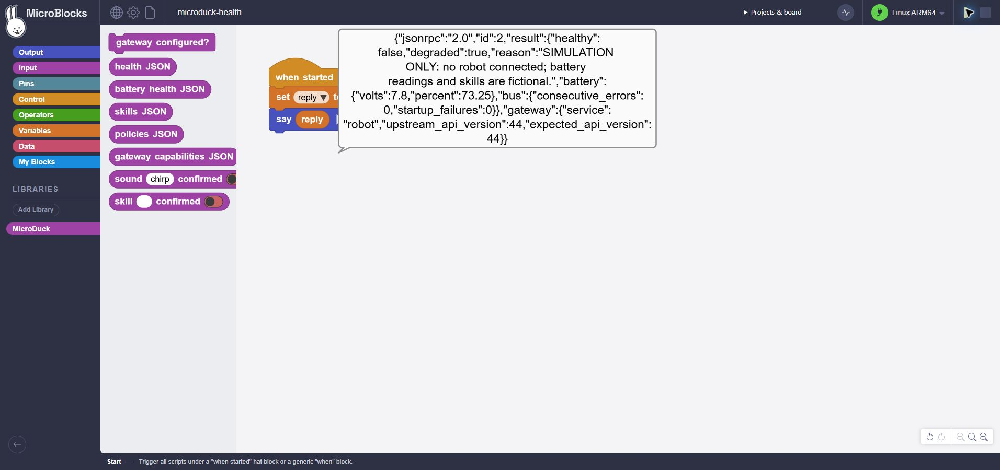

# Native adapter evidence

These results validate software preparation, not a physical MicroDuck robot.
The Pi is Raspberry Pi 5 / Debian 13.4 AArch64 / GCC 14.2. All robot responses
and actions in these tests are simulated. No motor, camera, BLE credential,
robot daemon installation or existing Pi service is involved.

| Evidence | Actual scope |
|---|---|
| [pi5-adapter-sanitizers.json](pi5-adapter-sanitizers.json) | Ten feature tests on real native AArch64 SmallVM under ASan/UBSan, official bytecode/PT​Y, real C adapter and Python gateway, simulated robot services. |
| [pi5-adapter-ordinary.json](pi5-adapter-ordinary.json) | Same ten feature tests on the ordinary optimized native binary. |
| [native-fixtures-sanitizers.json](native-fixtures-sanitizers.json) | 380 native fixture checks with real VM memory/Unix sockets and synthetic peer/write failures. Test timeout is 40 ms; production timeout is 10 seconds. |
| [pi5-adapter-source-manifest.json](pi5-adapter-source-manifest.json) | Exact source/dependency hashes for the ordinary Pi build, including pinned yyjson. |
| [pi5-graphical-simulation.json](pi5-graphical-simulation.json) | Real GP editor compiled the health example; real Pi executed its cooperative block functions and C jobs; an explicit simulation returned fictional health data through the real gateway. |
| [pi5-adapter-installer.json](pi5-adapter-installer.json) | Actual candidate install/reinstall/checksum failure/upgrade/uninstall preserving real programs. No service installed. |
| [pi5-adapter-rebuild.txt](pi5-adapter-rebuild.txt) | Identical second native-build checksum, libc-only linkage and glibc 2.34 minimum symbol version. |

The ordinary binary SHA-256 is
`0365d817036b74819f27ea405f8036f2d892f503891a03d561eb9e1c12f51ef2`.
The separate core protocol runner passed 100 arithmetic executions and the
existing upload/edit/stop/persistence/corruption cases with this build. Its
bounded idle sample was 3,358,720 bytes RSS and zero CPU ticks over about 0.5 s;
this is not a sustained performance or leak benchmark.

The native feature suite covers pending-job moving GC, a delayed reply while a
second VM task runs, actual production timeout, confirmation/operator/discovery
gates, bounded retained slots, Stop All unknown outcomes and recovery via
`jobs`, strict JSON/IDs, UTF-8 quoting, transport loss and no automatic replay.
The independent simulator CLI passed six tests. Required Linux repository
validation passed 163 tests without skips; the selected Node suites passed 64.

The graphical test found and corrected a library compiler mismatch: MicroBlocks
block code requires `repeatUntil`, not the GP implementation language's `while`.
After the fix, all required functions uploaded and the health program completed.

Reproduce this feature only with `tests/test_linux_microduck_vm.py`. For an
already built executable, set `SMALLVM_MICRODUCK_BINARY` to its absolute path.
`tools/run_pi5_microduck.py --native-evidence PATH` runs only this new feature
suite on an already verified Pi binary. It does not invoke the separate numeric
acceptance suite, configure credentials, change services or use robot hardware.

The demo backend defaults to read-only. The retained graphical test issued no
sound or skill request. Physical MicroDuck commissioning, shipping API/OS
compatibility, sensors, motion safety, full OS reboot and release publication
remain separate gates.

## Commissioning and delivery preparation checkpoint

The later local browser lab is a separate in-memory simulation. It passed
14 new Node tests and actual Edge UI checks for fictional identity/battery,
network/sound/skill confirmation, consumed checkboxes and reset. It never uses
BLE, a robot socket or the native VM. See [guide](../docs/commissioning-browser.md),
[scoped report](browser-commissioning.json) and
[packaging regression comparison](commissioning-packaging-regression.json).
All seven editor JavaScript/data hashes remained unchanged when the lab was added.

Final required Linux validation passed **173 tests with zero skips**; the final
selected Node run passed **91 tests with zero skips**. The additive CI workflow's
embedded local WSL selection passed 100 tests without skips plus its real
sanitizer VM and native fixtures. These are local results; no hosted CI run is
claimed. [Validation summary](commissioning-validation.json) retains log hashes
and links to the source-candidate/Pi rebuild receipts. The full
[status matrix](../../../docs/PI5_MICRODUCK_STATUS.md) and
[integration plan](../../../docs/LINUX_MICRODUCK_INTEGRATION_PLAN.md) include
remaining work and the two untouched denied actions.
